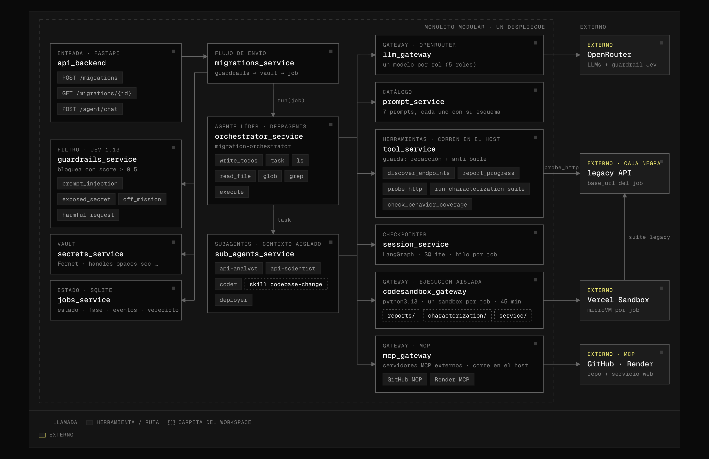
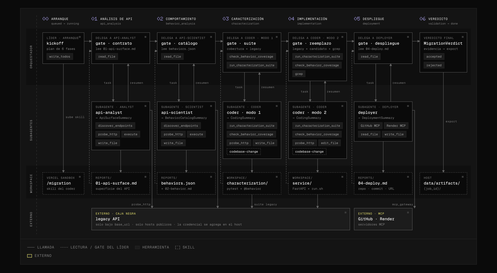

<p align="center">
  <picture>
    <source media="(prefers-color-scheme: light)" srcset="assets/frontier-logo-light.svg">
    
  </picture>
</p>

<h1 align="center">La Caja Negra</h1>

<p align="center">
  <strong>No solo una demo: una arquitectura lista para grandes empresas.</strong><br>
  Un agente que entiende un API heredado sin código ni documentación y construye un reemplazo que se comporta exactamente igual, incluidos sus errores.
</p>

<p align="center">
  <strong>Frontier Hackathon</strong> · Bogotá 26 · <a href="https://frontier.lab10.ai/">frontier.lab10.ai</a>
</p>

<p align="center">
  <code>Cloud-ready</code> · <code>Segura</code> · <code>Guardrails</code> · <code>Límites</code> · <code>Escalable</code> · <code>Lista para microservicios</code> · <code>Secretos y PII</code> · <code>Network isolation</code>
</p>

<p align="center">
  <a href="#arranque-rápido">Arranque rápido</a> ·
  <a href="#arquitectura">Arquitectura</a> ·
  <a href="#nueve-decisiones-enterprise">Nueve decisiones</a> ·
  <a href="#flujo-de-una-migración">Flujo del agente</a> ·
  <a href="https://claude.ai/artifact/ConqAhdJcUNAKpSwLVnqhQ">Versión interactiva ↗</a>
</p>

---

## Arranque rápido

### Requisitos

- Python 3.11+ y [`uv`](https://docs.astral.sh/uv/)
- Docker corriendo (es el sandbox local donde se ejecuta el código de los agentes)
- `pnpm` 10 (opcional, para usar los scripts del monorepo)
- Una API key de [OpenRouter](https://openrouter.ai/)

### 1. Configura las variables de entorno

```bash
cp apps/backend/.env.example apps/backend/.env
```

| Variable | Requerida | Para qué sirve |
|---|:---:|---|
| `FRONTIER_PLATFORM_API_KEY` | ✅ | Bearer que exigen todas las rutas de `/migrations` y `/agent`. Usa cualquier valor largo y aleatorio. |
| `FRONTIER_SECRETS_MASTER_KEY` | ✅ | Llave Fernet del vault. Genérala con el comando de abajo. |
| `OPENROUTER_API_KEY` | ✅ | Modelos de los agentes y modelo de decisión de guardrails. |
| `FRONTIER_SANDBOX_PROVIDER` | ✅ | `docker` en local; `vercel` en la nube (valor por defecto si no se define). |
| `VERCEL_TOKEN` · `VERCEL_TEAM_ID` · `VERCEL_PROJECT_ID` | solo con `vercel` | Credenciales de Vercel Sandbox. |
| `LANGSMITH_API_KEY` · `LANGSMITH_PROJECT` | opcional | Trazas de cada run. Sin cuenta, pon `LANGSMITH_TRACING=false`. |

```bash
# Genera FRONTIER_SECRETS_MASTER_KEY
cd apps/backend && uv run python -c "from cryptography.fernet import Fernet; print(Fernet.generate_key().decode())"
```

Los modelos por rol, timeouts, límites de concurrencia y umbrales de guardrails son opcionales y están documentados en [`apps/backend/.env.example`](apps/backend/.env.example).

### 2. Levanta el backend

```bash
pnpm --filter @frontier/backend dev
# sin pnpm: cd apps/backend && uv run uvicorn frontier.app:app --app-dir src --reload --port 8000 --env-file .env
```

Con `FRONTIER_SANDBOX_PROVIDER=vercel` también puedes usar `docker compose up --build`. La imagen del backend no incluye el CLI de Docker, así que el sandbox `docker` solo funciona corriendo el backend directo en tu máquina.

### 3. Lanza una migración

```bash
curl http://localhost:8000/health

curl -X POST http://localhost:8000/migrations \
  -H "Authorization: Bearer $FRONTIER_PLATFORM_API_KEY" \
  -H "Content-Type: application/json" \
  -d '{
    "base_url": "https://legacy.example.com",
    "service_key": "<llave-del-servicio>",
    "team_token": "<token-del-equipo>",
    "context": "API de pedidos, 2014"
  }'
# → 202 {"job_id": "...", "status": "queued", "status_url": "/migrations/..."}

curl http://localhost:8000/migrations/<job_id> -H "Authorization: Bearer $FRONTIER_PLATFORM_API_KEY"
```

Los artefactos de cada job (reportes, suite de caracterización y servicio de reemplazo) quedan en `apps/backend/data/artifacts/{job_id}`.

---

## Arquitectura

> **El foco no fue solo crear el agente, sino una arquitectura _enterprise grade_ para ejecutarlo en la nube: segura, con guardrails, con límites claros y lista para escalar.**

<p align="center">
  
</p>

<p align="center">
  <sub>Trece módulos activos en un solo despliegue. Las flechas van de quien llama a quien responde. Solo las herramientas del host, el sandbox y <code>mcp_gateway</code> salen hacia afuera.<br>
  <a href="https://claude.ai/artifact/ConqAhdJcUNAKpSwLVnqhQ">Ver la versión animada, que recorre una migración de punta a punta ↗</a></sub>
</p>

## Nueve decisiones enterprise

Un agente que funciona en una laptop no basta para una empresa. Este recibe credenciales de producción, ejecuta código que él mismo escribe y llama a sistemas críticos. Estas son las nueve decisiones que hacen que la plataforma que lo rodea esté a la altura.

<table>
  <tr>
    <td width="33%" valign="top">
      <sub><b>01 · ARQUITECTURA</b></sub>
      <h3>Monolito modular hoy, microservicios mañana</h3>
      Por el tiempo de la hackathon corre en un solo proceso, pero cada módulo ya tiene su contrato y su cliente. Pasarlo a microservicio es cambiar solo el cliente.
      <br><br><code>monolito modular → microservicios</code>
    </td>
    <td width="33%" valign="top">
      <sub><b>02 · LLM GATEWAY</b></sub>
      <h3>Un único punto de consumo de LLMs</h3>
      Todos los modelos pasan por <code>llm_gateway</code>. Eso permite usar proxies internos y LLMs que no salen a internet, todo dentro de una VPC privada.
      <br><br><code>proxy interno · sin salida a internet · VPC privada</code>
    </td>
    <td width="33%" valign="top">
      <sub><b>03 · VAULT</b></sub>
      <h3>Secretos aislados en un vault</h3>
      Las credenciales se cifran al entrar. El resto del sistema solo ve handles opacos y toda salida se redacta.
      <br><br><code>service_key → sec_7c1e… → [REDACTED]</code>
    </td>
  </tr>
  <tr>
    <td valign="top">
      <sub><b>04 · TOKENS</b></sub>
      <h3>Los subagentes nunca ven el token</h3>
      Para probar el API heredado, <code>tool_service</code> resuelve el secreto en el host y lo inyecta en la llamada. El agente solo recibe la respuesta.
      <br><br><code>subagente → + token → legacy API</code>
    </td>
    <td valign="top">
      <sub><b>05 · GUARDRAILS</b></sub>
      <h3>Una capa de seguridad antes de gastar</h3>
      Cada solicitud se filtra antes de tocar almacenamiento o sandbox. La capa es compatible con los nuevos modelos de decisión de AWS o con Amazon Bedrock Guardrails.
      <br><br><code>Jev 1.13 hoy · modelos de decisión AWS · Bedrock Guardrails</code>
    </td>
    <td valign="top">
      <sub><b>06 · JOBS ASYNC</b></sub>
      <h3>Jobs asíncronos con polling</h3>
      La API responde <code>202</code> con un <code>job_id</code> y la migración corre en segundo plano. Así escala a muchas migraciones de cajas negras en paralelo.
      <br><br><code>POST → 202 job_id → GET polling</code>
    </td>
  </tr>
  <tr>
    <td valign="top">
      <sub><b>07 · CODE SANDBOX</b></sub>
      <h3>El código nunca corre en el servidor</h3>
      Todo lo que escriben los agentes se ejecuta en un sandbox aislado por job. El gateway es compatible con Langfuse Sandbox o con las microVMs de agentes de AWS.
      <br><br><code>Vercel Sandbox · Docker hoy · AWS AgentCore microVM</code>
    </td>
    <td valign="top">
      <sub><b>08 · MCP GATEWAY</b></sub>
      <h3>Credenciales externas en un solo lugar</h3>
      <code>mcp_gateway</code> centraliza las credenciales de plataformas externas y permite crear adaptadores propios con filtros de seguridad corporativos.
      <br><br><code>adaptadores propios · OAuth · SSO</code>
    </td>
    <td valign="top">
      <sub><b>09 · TOOL SERVICE</b></sub>
      <h3>Una sola puerta a los sistemas internos</h3>
      <code>tool_service</code> es el único punto de entrada a las herramientas que tocan sistemas internos: usa los routers internos de la VPC y se conecta con otros subsistemas de la corporación.
      <br><br><code>routers de la VPC · subsistemas corporativos</code>
    </td>
  </tr>
</table>

## Garantías en tiempo de ejecución

| Principio | Cómo se cumple |
|---|---|
| **Las credenciales nunca llegan al modelo** | `service_key` y `team_token` se cifran con Fernet al entrar. El resto del sistema solo ve handles opacos `sec_…`. Las herramientas resuelven el valor en el host o lo inyectan como variable de entorno en el sandbox, y toda salida se redacta antes de volver al agente o al job. |
| **Filtrar antes de gastar** | `guardrails_service` revisa cada solicitud antes de tocar almacenamiento o sandbox: detecta secretos pegados en el texto y evalúa `prompt_injection`, `exposed_secret`, `off_mission` y `harmful_request` con un modelo de decisión. Bloquea con score ≥ 0,5 (`422`) y falla cerrado si el modelo no responde (`503`). |
| **Ejecución aislada** | Todo el código que escriben los agentes corre en un sandbox propio por job: Vercel Sandbox (microVM) en la nube, Docker en local. |
| **Superficie de red acotada** | `probe_http` solo alcanza rutas bajo la `base_url` del job, rechaza hosts que no resuelven a IPs públicas (protección SSRF) y no sigue redirecciones. |
| **Evidencia, no confianza** | Cada fase tiene un gate que el líder verifica con herramientas deterministas. Un `accepted` sin las dos suites en verde, con behaviors sin cubrir o con fases rechazadas se baja a `rejected`. |
| **Límites explícitos** | Máximo de jobs concurrentes, tres intentos por fase y un deadline por run. El sandbox reserva un margen al final para exportar los artefactos, aunque el run falle. |
| **Mínimo privilegio por agente** | Cada agente recibe solo sus herramientas. El líder lee pero no escribe en el workspace; los subagentes escriben pero no delegan ni reportan al job. |
| **Contexto aislado** | Los subagentes no ven la conversación del líder. Reciben un brief autocontenido, dejan resultados en el workspace compartido y devuelven un resumen estructurado. |
| **Observabilidad** | Logs estructurados (`structlog`, formato JSON), trazas de cada run en LangSmith y estado durable del job con sus últimos eventos. |

## Monolito modular, listo para microservicios

El diseño objetivo es de microservicios. Para la hackathon todo corre en un solo proceso FastAPI, sin perder los límites entre módulos:

- Cada módulo expone **contratos** (`contracts/`) y un **cliente** (`clients/`); ningún módulo importa la implementación de otro.
- `container.py` es el único lugar que instancia servicios y los conecta.
- Pasar un módulo a servicio independiente solo exige cambiar su cliente por uno HTTP o de cola. Los consumidores no cambian.

| Capa | Módulo | Responsabilidad |
|---|---|---|
| Entrada y control | `api_backend` | Punto único de entrada con API key de plataforma (Bearer). `POST /migrations` responde `202` con un `job_id`; la migración sigue en segundo plano. |
| Entrada y control | `migrations_service` | Coordina cada envío en orden: guardrails → vault → job → orquestador, con un límite de jobs concurrentes. |
| Entrada y control | `guardrails_service` | Filtro de seguridad previo a cualquier gasto de infraestructura. |
| Entrada y control | `secrets_service` | Vault: cifrado Fernet, handles opacos, resolución en el host y redacción. |
| Entrada y control | `jobs_service` | Estado durable de cada migración: estado, fase, eventos, veredicto y ruta de artefactos. |
| Agentes | `orchestrator_service` | Agente líder (`deepagents` sobre LangGraph). Planifica, delega, corre los gates y emite un `MigrationVerdict`. |
| Agentes | `sub_agents_service` | `api-analyst`, `api-scientist` y `coder` (más `deployer`, en construcción), cada uno con su prompt, su modelo, sus herramientas y su salida estructurada. |
| Plataforma | `llm_gateway` | Consumo unificado de LLMs vía OpenRouter, con un modelo configurable por rol. |
| Plataforma | `prompt_service` | Catálogo central de prompts con su esquema de salida, validado al arrancar. |
| Plataforma | `tool_service` | Herramientas que corren en el host, para que la credencial nunca entre al contexto del agente. |
| Plataforma | `session_service` | Checkpointer de LangGraph sobre SQLite: un hilo por job o por sesión de chat. |
| Plataforma | `codesandbox_gateway` | Un sandbox por job con workspace compartido; exporta los artefactos al terminar. |
| Plataforma | `mcp_gateway` | Integración con servidores MCP externos (GitHub, Render). |

## Flujo de una migración

El líder planifica con `write_todos`, delega cada fase con `task` a un subagente y no avanza hasta que el gate pasa. Si falla, vuelve a delegar con los motivos exactos, hasta tres intentos por fase.

<p align="center">
  
</p>

| # | Fase | Quién | Gate |
|---|---|---|---|
| 1 | Contrato | `api-analyst` | `01-api-surface.md` documenta auth, convenciones y endpoints. |
| 2 | Comportamiento | `api-scientist` | `behaviors.json` cubre éxito, validación, auth, not-found y método no permitido por endpoint. |
| 3 | Caracterización | `coder` (modo 1) | Cobertura completa (`check_behavior_coverage`) y suite en verde contra el legacy. |
| 4 | Reemplazo | `coder` (modo 2) | Suite en verde contra legacy **y** candidato, sin asserts debilitados ni tests saltados. |
| 5 | Despliegue *(en construcción)* | `deployer` | Repositorio, commit y URL del servicio respondiendo. |
| 6 | Veredicto | líder | `MigrationVerdict` validado contra la evidencia; el workspace se exporta a `data/artifacts/{job_id}`. |

## El reto

Heredamos un servicio con 10 años en producción. No hay código fuente ni documentación, y las dos personas que lo escribieron ya no están. Sabemos que recibe mensajes y responde, y que si lo apagamos la empresa se cae.

**Hay que entenderlo por completo y construir un reemplazo que se comporte exactamente igual, incluidos sus errores.** Entre el líder y sus cuatro subagentes documentan el API, catalogan cada comportamiento, lo convierten en una suite de caracterización y construyen un reemplazo en FastAPI que la pasa igual que el original. El veredicto solo se acepta con evidencia.

## Stack

| Área | Tecnología |
|---|---|
| API | FastAPI · Pydantic v2 · uvicorn |
| Agentes | `deepagents` sobre LangGraph |
| Modelos | OpenRouter, uno por rol; guardrails con `typesafe/jev-1.13` |
| Ejecución | Vercel Sandbox (nube) · Docker (local) |
| Estado | SQLite (jobs, secretos, checkpoints) |
| Observabilidad | structlog · LangSmith |
| Monorepo | pnpm · Turborepo · uv |

## Estado

- [x] Arquitectura enterprise: guardrails, vault, jobs, límites, sandbox por job
- [x] Agente líder y subagentes de discovery, caracterización y reemplazo
- [x] Sandbox Vercel (nube) y Docker (local)
- [x] Trazas en LangSmith
- [ ] Despliegue automático del reemplazo (`deployer` y `mcp_gateway` en construcción)
- [ ] Separación en microservicios

---

<p align="center">
  <picture>
    <source media="(prefers-color-scheme: light)" srcset="assets/frontier-logo-light.svg">
    
  </picture><br>
  <sub>Construido para <a href="https://frontier.lab10.ai/">Frontier</a> by <a href="https://lab10.ai">Lab10</a> · Bogotá 26</sub>
</p>
