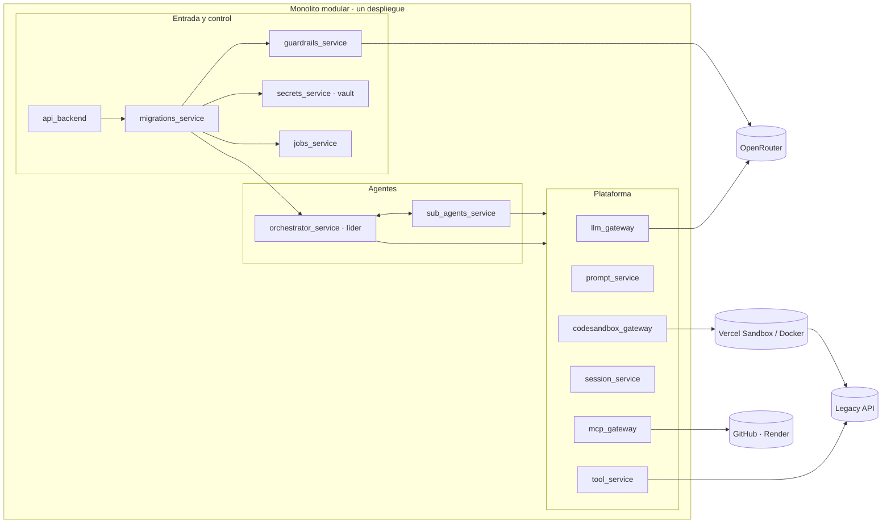

<p align="center">
  
</p>

<h1 align="center">La Caja Negra</h1>

<p align="center">
  <strong>Frontier Hackathon</strong> · <a href="https://frontier.lab10.ai/">frontier.lab10.ai</a>
</p>

<p align="center">
  <code>Cloud-ready</code> · <code>Segura</code> · <code>Guardrails</code> · <code>Límites</code> · <code>Escalable</code> · <code>Lista para microservicios</code> · <code>Secretos y PII</code>
</p>

---

> **El foco no fue solo crear el agente, sino una arquitectura _enterprise grade_ para ejecutarlo en la nube: segura, con guardrails, con límites claros y lista para escalar.**

📐 **Arquitectura interactiva** (mapa del sistema, flujo del agente, matriz de herramientas y decisiones): <https://claude.ai/artifact/ConqAhdJcUNAKpSwLVnqhQ>

## El reto

Heredamos un servicio con 10 años en producción. No hay código fuente ni documentación, y las dos personas que lo escribieron ya no están. Sabemos que recibe mensajes y responde, y que si lo apagamos la empresa se cae.

**Hay que entenderlo por completo y construir un reemplazo que se comporte exactamente igual, incluidos sus errores.**

## La solución

Una plataforma de migración que recibe la URL de un API heredado y la entrega a un agente líder con cuatro subagentes especializados. Entre todos documentan el API, catalogan cada comportamiento (errores incluidos), lo convierten en una suite de caracterización y construyen un reemplazo en FastAPI que la pasa igual que el original. **El veredicto solo se acepta con evidencia.**

Un agente que funciona en una laptop no basta para una empresa. Este agente recibe credenciales de producción, ejecuta código que él mismo escribe y llama a sistemas críticos. Por eso la plataforma que lo rodea importa tanto como el agente.

## Principios de arquitectura

| Principio | Cómo se cumple |
|---|---|
| **Las credenciales nunca llegan al modelo** | `service_key` y `team_token` se cifran con Fernet al entrar. El resto del sistema solo ve handles opacos `sec_…`. Las herramientas resuelven el valor en el host o lo inyectan como variable de entorno en el sandbox, y toda salida se redacta antes de volver al agente o al job. |
| **Filtrar antes de gastar** | `guardrails_service` revisa cada solicitud antes de tocar almacenamiento o sandbox: detecta secretos pegados en el texto y evalúa `prompt_injection`, `exposed_secret`, `off_mission` y `harmful_request` con un modelo de decisión. Bloquea con score ≥ 0,5 (`422`) y falla cerrado si el modelo no responde (`503`). |
| **Ejecución aislada** | Todo el código que escriben los agentes corre en un sandbox propio por job: Vercel Sandbox (microVM) en la nube, Docker en local. |
| **Superficie de red acotada** | `probe_http` solo alcanza rutas bajo la `base_url` del job, rechaza hosts que no resuelven a IPs públicas (protección SSRF) y no sigue redirecciones. |
| **Evidencia, no confianza** | Cada fase tiene un gate que el líder verifica con herramientas deterministas. Un `accepted` sin las dos suites en verde, con behaviors sin cubrir o con fases rechazadas se baja a `rejected`. |
| **Límites explícitos** | Máximo de jobs concurrentes, tres intentos por fase y un deadline por run. El sandbox reserva un margen al final para exportar los artefactos, aunque el run falle. |
| **Mínimo privilegio por agente** | Cada agente recibe solo sus herramientas. El líder lee pero no escribe en el workspace; los subagentes escriben pero no delegan ni reportan al job. |
| **Contexto aislado** | Los subagentes no ven la conversación del líder. Reciben un brief autocontenido, dejan resultados en el workspace compartido y devuelven un resumen estructurado. |
| **Observabilidad** | Logs estructurados (`structlog`, formato JSON), trazas de cada run en LangSmith y estado durable del job con sus últimos eventos. |

## Monolito modular, listo para microservicios

El diseño objetivo es de microservicios. Para la hackathon todo corre en un solo proceso FastAPI, sin perder los límites entre módulos:

- Cada módulo expone **contratos** (`contracts/`) y un **cliente** (`clients/`); ningún módulo importa la implementación de otro.
- `container.py` es el único lugar que instancia servicios y los conecta.
- Pasar un módulo a servicio independiente solo exige cambiar su cliente por uno HTTP o de cola. Los consumidores no cambian.



### Módulos por capa

| Capa | Módulo | Responsabilidad |
|---|---|---|
| Entrada y control | `api_backend` | Punto único de entrada con API key de plataforma (Bearer). `POST /migrations` responde `202` con un `job_id`; la migración sigue en segundo plano. |
| Entrada y control | `migrations_service` | Coordina cada envío en orden: guardrails → vault → job → orquestador, con un límite de jobs concurrentes. |
| Entrada y control | `guardrails_service` | Filtro de seguridad previo a cualquier gasto de infraestructura. |
| Entrada y control | `secrets_service` | Vault: cifrado Fernet, handles opacos, resolución en el host y redacción. |
| Entrada y control | `jobs_service` | Estado durable de cada migración: estado, fase, eventos, veredicto y ruta de artefactos. |
| Agentes | `orchestrator_service` | Agente líder (`deepagents` sobre LangGraph). Planifica, delega, corre los gates y emite un `MigrationVerdict`. |
| Agentes | `sub_agents_service` | `api-analyst`, `api-scientist` y `coder` (más `deployer`, en construcción), cada uno con su prompt, su modelo, sus herramientas y su salida estructurada. |
| Plataforma | `llm_gateway` | Consumo unificado de LLMs vía OpenRouter, con un modelo configurable por rol. |
| Plataforma | `prompt_service` | Catálogo central de prompts con su esquema de salida, validado al arrancar. |
| Plataforma | `tool_service` | Herramientas que corren en el host, para que la credencial nunca entre al contexto del agente. |
| Plataforma | `session_service` | Checkpointer de LangGraph sobre SQLite: un hilo por job o por sesión de chat. |
| Plataforma | `codesandbox_gateway` | Un sandbox por job con workspace compartido; exporta los artefactos al terminar. |
| Plataforma | `mcp_gateway` | Integración con servidores MCP externos (GitHub, Render). |

## Flujo de una migración

El líder no avanza de fase hasta que el gate pasa. Si falla, vuelve a delegar con los motivos exactos, hasta tres intentos por fase.

| # | Fase | Quién | Gate |
|---|---|---|---|
| 1 | Contrato | `api-analyst` | `01-api-surface.md` documenta auth, convenciones y endpoints. |
| 2 | Comportamiento | `api-scientist` | `behaviors.json` cubre éxito, validación, auth, not-found y método no permitido por endpoint. |
| 3 | Caracterización | `coder` (modo 1) | Cobertura completa (`check_behavior_coverage`) y suite en verde contra el legacy. |
| 4 | Reemplazo | `coder` (modo 2) | Suite en verde contra legacy **y** candidato, sin asserts debilitados ni tests saltados. |
| 5 | Despliegue *(en construcción)* | `deployer` | Repositorio, commit y URL del servicio respondiendo. |
| 6 | Veredicto | líder | `MigrationVerdict` validado contra la evidencia; el workspace se exporta a `data/artifacts/{job_id}`. |

## Stack

| Área | Tecnología |
|---|---|
| API | FastAPI · Pydantic v2 · uvicorn |
| Agentes | `deepagents` sobre LangGraph |
| Modelos | OpenRouter, uno por rol; guardrails con `typesafe/jev-1.13` |
| Ejecución | Vercel Sandbox (nube) · Docker (local) |
| Estado | SQLite (jobs, secretos, checkpoints) |
| Observabilidad | structlog · LangSmith |
| Monorepo | pnpm · Turborepo · uv |

## Correr en local

```bash
cp apps/backend/.env.example apps/backend/.env
# Completa FRONTIER_PLATFORM_API_KEY, FRONTIER_SECRETS_MASTER_KEY y OPENROUTER_API_KEY.
# FRONTIER_SANDBOX_PROVIDER=docker usa Docker local; vercel requiere VERCEL_TOKEN, VERCEL_TEAM_ID y VERCEL_PROJECT_ID.

docker compose up --build      # o: pnpm --filter @frontier/backend dev
```

La API queda en `http://localhost:8000`. Todas las variables están documentadas en [`apps/backend/.env.example`](apps/backend/.env.example).

## Estado

- [x] Arquitectura enterprise: guardrails, vault, jobs, límites, sandbox por job
- [x] Agente líder y subagentes de discovery, caracterización y reemplazo
- [x] Sandbox Vercel (nube) y Docker (local)
- [x] Trazas en LangSmith
- [ ] Despliegue automático del reemplazo (`deployer` y `mcp_gateway` en construcción)
- [ ] Separación en microservicios

---

<p align="center">
  <sub>Construido para <a href="https://frontier.lab10.ai/">Frontier</a> by <a href="https://lab10.ai">Lab10</a> · Bogotá 26</sub>
</p>
