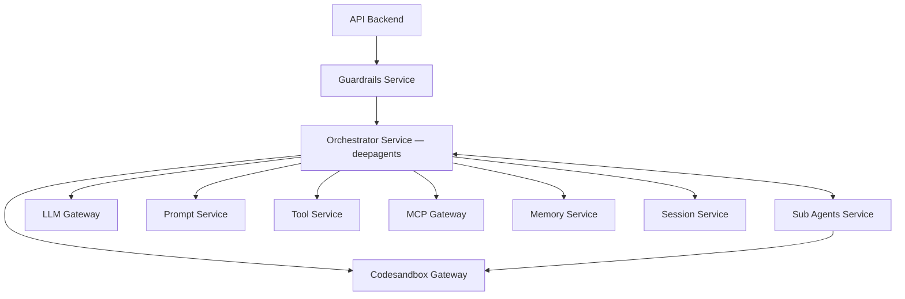

  

<h1 align="center">La Caja Negra</h1>

  <strong>Frontier Hackathon</strong> · <a href="https://frontier.lab10.ai/">frontier.lab10.ai</a>

---

> Descubre cómo se comporta un servicio sin documentación y construye un reemplazo que responda exactamente igual.

## El desafío

Heredamos un servicio que lleva 10 años en producción. Nadie sabe qué hace exactamente. No hay código fuente, no hay documentación y las dos personas que lo escribieron ya no están. Sabemos que recibe mensajes y responde, y que si lo apagamos la empresa se cae.

**Necesitamos entenderlo por completo y construir un reemplazo que se comporte exactamente igual, incluidos sus errores.**

## Arquitectura de la solución

Un agente de migración con acceso a *codesandboxes* para ejecución segura de código, y memoria de largo plazo para proyectos multisesión.

> 📐 Ver el diagrama completo: [`docs/architecture.html`](docs/architecture.html)

### Componentes

| Capa | Componente | Responsabilidad |
|---|---|---|
| Ingreso | **API Backend** | Punto único de entrada; recibe solicitudes y dispara el flujo. |
| Ingreso | **Guardrails Service** | Analiza cada solicitud antes de levantar la infraestructura; scope acotado, resistencia a prompt injections. |
| Núcleo | **Orchestrator Service** | Agente orquestador (`deepagents`); planifica y conduce el flujo hasta la ejecución total de la migración. |
| Núcleo | **Sub Agents Service** | Subagentes especializados; distribuyen carga y acotan el consumo de contexto. |
| Capacidades | **LLM Gateway** | Consumo unificado de LLMs. |
| Capacidades | **Prompt Service** | Gestión centralizada de prompts. |
| Capacidades | **Tool Service** | Tools internas para agentes y subagentes. |
| Capacidades | **MCP Gateway** | Consumo e integración de MCPs. |
| Memoria | **Memory Service** | Memoria de largo plazo: artefactos, estado y antecedentes por proyecto de migración. |
| Memoria | **Session Service** | Historial de la sesión con el agente. |
| Ejecución | **Codesandbox Gateway** | Ejecución segura de código en sandboxes aisladas. |

Las migraciones son proyectos de largo plazo: pueden requerir múltiples sesiones o quedar a mitad de camino. La memoria de largo plazo permite al agente retomar el trabajo conociendo el estado exacto y los antecedentes del servicio a migrar.

**Nota de implementación:** el diseño objetivo es de microservicios; para la hackathon se implementa como un **monolito modular**, preservando los límites entre módulos.

## Estado

- [x] Definición de arquitectura
- [ ] Fase de discovery del servicio (caja negra)
- [ ] Construcción del reemplazo
- [ ] Validación de equivalencia de comportamiento

---

  Construido para <a href="https://frontier.lab10.ai/">Frontier</a> by <a href="https://lab10.ai">Lab10</a> · Bogotá 26

